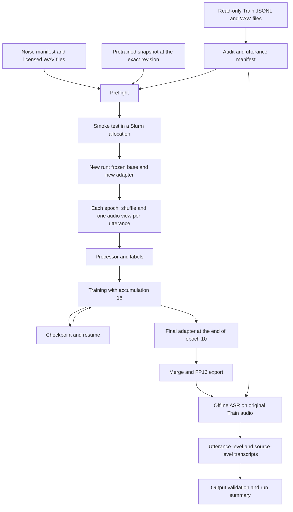

# PhoWhisper-large LoRA ASR System Specification

**Version:** 1.0 — 2026-11-06.  
**Status:** specification for implementation; the server environment has not been verified, and implementation and full training have not been performed.  
**Current scope:** specification authoring; the files, modules, and commands below describe interfaces to be implemented.

## 1. Objectives and Requirement Sources

Build a Vietnamese ASR fine-tuning system for Zalo AI Challenge 2026 — LifeMate. The system fine-tunes PhoWhisper-large with LoRA on the entire Train dataset, exports an FP16 model for offline execution, and then transcribes the original Train audio to produce transcripts for downstream LLM fine-tuning.

Requirement sources, in descending order of precedence:

1. The attached user request titled **“TASK: Build Complete PhoWhisper-Large LoRA ASR Fine-Tuning System”**, particularly its **FINAL LOCKED CONFIG**.
2. [ASR.md](../ASR.md), for details not superseded by the locked requirements.
3. The README and source data under `train+public_test/train+public_test/` in the inspected workspace.
4. Implementation decisions explicitly documented in this specification, solely to complete the technical contracts without changing the locked methodology.

The `encoder_decoder` LoRA scope, 10 epochs, no validation, and no deduplication are final decisions. The `decoder` option, “proposed” epoch budget, and possible deduplication described in ASR.md do not apply to this official run. This is a new run initialized from the pretrained base, rather than an exact reproduction of E4 or a warm start from E4.

Success is defined by pipeline correctness, evidence that the full training budget was completed, resumability, and complete final artifacts. No WER threshold or quality improvement is promised without appropriate measurements; public/private test data must not be used for model selection.

## 2. System Scope

The system must provide:

- Dataset, WAV, transcript, and duplicate/conflict auditing, with utterance manifest generation.
- Verification of the pretrained snapshot, noise assets, and execution environment.
- Seed-deterministic E4 augmentation, feature extraction, and label preparation.
- Initialization of the frozen base and encoder + decoder LoRA within the exact specified scope.
- Training for 10 epochs using the locked gradient accumulation, scheduler, and precision settings.
- Checkpointing, resume support, logging, and a verifiable run manifest.
- Slurm scripts for an H200 MIG `2g.35gb` GPU, preflight checks, and smoke tests.
- Final adapter merging, FP16 export, and offline inference on the original audio.
- Utterance-level and source-level transcripts with accurate history mappings.
- Tests, output validation, and a README covering the complete lifecycle.

The scope excludes implementing an LLM/tool-calling agent, generating a LifeMate submission, or using labeled tool calls, tool results, or environment state as ASR data. No external speech training data may be added. External non-speech noise is a separate, mandatory resource for the authorized augmentation policy.

## 3. Environment and Filesystem Boundaries

| Component | Deployment value |
|---|---|
| Operating system | Ubuntu |
| Login node | `login01` |
| GPU allocation | Slurm, one H200 MIG `2g.35gb` GPU instance |
| Project root | `/datastore/binhvp/BuiTrongTan/ASR` |
| Dataset root | `/datastore/binhvp/BuiTrongTan/data/train+public_test` |
| Train root | `/datastore/binhvp/BuiTrongTan/data/train+public_test/train` |
| Public Test root | `/datastore/binhvp/BuiTrongTan/data/train+public_test/public_test` |

All source code, configuration, project-managed environments/caches, model assets, checkpoints, logs, and outputs must reside under the project root. The dataset remains outside the project and is read in place; source data must not be moved, copied, or modified. The `CS406/` directory must not be accessed or modified.

The server paths differ from the nested directory structure in the Windows workspace being inspected. Windows paths must not be hard-coded into the Ubuntu runtime. `data_root` points to the directory that directly contains `train/` and `public_test/`; Train audio paths are resolved relative to `train/`.

The login node is limited to preparation and CPU tasks permitted by cluster policy. All GPU model loading, GPU preflight checks, smoke tests, training, and GPU-based merging/inference must run within an allocation on a compute node. Training must be submitted through Slurm; verify the allocation before initializing CUDA and refuse execution on the login node.

The account, partition, QoS, MIG GRES syntax, CPU count, RAM, and walltime depend on the cluster. Scripts must expose these settings and report missing values clearly; partition names must not be invented or treated as verified. Training across multiple allocations must continue the same run through resume, without changing the total of 10 epochs.

## 4. Dataset Identity and Data Contracts

### 4.1. Inspection Statistics

The JSONL files were read and files were counted in the current workspace:

| Split | Source samples | Current utterances | User history utterances | Total user utterances | WAV files |
|---|---:|---:|---:|---:|---:|
| Train | 1,545 | 1,545 | 3,491 | 5,036 | 5,036 |
| Public Test | 634 | 634 | 1,299 | 1,933 | 1,933 |

Reference SHA-256 for `train.jsonl`:

```text
24c42c79fbe8db932fe9817d041c0d0ca422ac8177b413cc1be0cda1fd8941a8
```

The Train hash in the inspected workspace matches this value. These counts do not establish WAV validity, complete mappings, the absence of transcript conflicts, or valid token lengths. The server audit must verify these properties against the actual data before training. Public Test contains neither `audio_text` nor labels; its statistics provide context only and are not inputs to the training run.

### 4.2. Source-to-Utterance Projection

Read each Train line as a source record containing `id`, `audio`, `audio_text`, and `history`. Source IDs must be nonempty and unique. Use only the fields required for projection; `context`, `label`, tool calls, and state must not be included in ASR artifacts.

- The current turn uses the source-level `audio` and `audio_text`, with `turn_id="current"`.
- Traverse history in its original order, selecting only turns with `role="user"` and using the audio/transcript belonging to that specific turn.
- A history turn uses `turn_id="history_NNN"`, where `NNN` is the original index starting at 0, padded to at least 3 digits. For example, a user at index 2 has `history_002` even if index 1 is an assistant turn.
- `utterance_id="<sample_id>/<turn_id>"` is unique and stable across auditing, training, resume, and inference.
- The manifest preserves source order from the JSONL file; within each source, it records the current turn first, followed by user history turns in ascending index order. Training shuffling changes traversal order only and does not modify the manifest.
- Assistant turns must not produce ASR rows. History indices must not be renumbered to count user turns only.

Each row in `utterances.jsonl` contains at least:

```json
{
  "sample_id": "train_0001",
  "turn_id": "current",
  "utterance_id": "train_0001/current",
  "audio": "audio/train_0001/train_0001.wav",
  "reference": "Nếu mai mưa thì dời chạy bộ muộn 1 tiếng, nhắn Sếp Dũng giờ mới; không mưa thì thôi.",
  "wav_sha256": "<hash computed from the entire WAV file>",
  "pcm_sha256": "<hash computed from the PCM payload>",
  "duration_seconds": 1.0
}
```

The hash and duration values in this example illustrate the schema only; actual artifacts must contain measured values. Additional fields may include `history_index`, `num_frames`, `sample_rate`, `channels`, `sample_width_bytes`, `normalized_reference`, and `label_token_count`; `history_index` is `null` for the current turn.

### 4.3. Mandatory Checks

- Accept only audio paths that resolve beneath `train/audio/`; reject path traversal, absolute paths outside the root, and symlinks escaping the root. Apply equivalent checks to noise assets and project output paths.
- Do not read, index, or copy `*_environment/`, `*_enviroment/`, hidden state, or gold tool calls. The JSONL may contain `label`; the reader must not use or export that field.
- WAV files must contain mono signed 16-bit PCM at 16 kHz, with `0 < duration <= 30` seconds. Verify the header, the actual number of frames read, an untruncated payload, and finite waveform values.
- Decode PCM to floating point by dividing by `32768.0`; do not resample, crop, or modify input files to make them pass the audit.
- Transcripts must be strings that remain nonempty after Unicode NFC normalization and trimming at both ends. Preserve the original in `reference`; do not lowercase, remove diacritics, rewrite numbers, or apply WER normalization to training targets.
- `wav_sha256` hashes the entire file; `pcm_sha256` hashes the PCM bytes read from a valid WAV. Because the input format is fixed, use the PCM hash to detect duplicate audio independently of WAV metadata.
- Report groups sharing a WAV hash, PCM hash, or PCM + normalized reference, including all provenance. Retain every occurrence in training.
- Identical PCM with different normalized references constitutes a conflict and must halt processing for review. Do not automatically choose a transcript, merge groups, or drop rows.
- Missing files, invalid audio formats, invalid transcripts, duplicate source/utterance IDs, and excessive label lengths must be reported with their IDs, paths, and reasons.

“Reject” means flagging an error and failing preflight, rather than silently dropping a row and training on a smaller dataset. The official run must use all 1,545 sources and every valid user utterance belonging to them. A hash/count mismatch against the reference identity must block the run pending investigation; expected values must not be updated automatically, and no new split may be created.

## 5. Final Locked Configuration

The configuration must have a schema with type/value validation and distinguish locked methodology fields from operational fields such as paths, Slurm resources, and run names. The CLI must not silently override locked values.

```yaml
model:
  base: vinai/PhoWhisper-large
  revision: b9136a44b5f2ca664bd0b8f74baecf1715f6eeeb
  frozen_base: true
  quantization: null
  trust_remote_code: false

data:
  source_samples: 1545
  expected_utterances: 5036
  include_current: true
  include_user_history: true
  include_assistant: false
  validation: false
  deduplicate: false

lora:
  scope: encoder_decoder
  rank: 8
  alpha: 16
  dropout: 0.05
  bias: none
  modules_to_save: null

training:
  seed: 42
  epochs: 10
  micro_batch_size: 1
  gradient_accumulation_steps: 16
  optimizer: AdamW
  learning_rate: 0.0001
  betas: [0.9, 0.999]
  epsilon: 1.0e-8
  weight_decay: 0.01
  scheduler: linear
  warmup_ratio: 0.05
  max_grad_norm: 1.0
  gradient_checkpointing: true
  use_cache: false
  precision: auto
  checkpoint_every_updates: 50
  early_stopping: false

augmentation:
  policy: augmentation-v1
  branch_probability: 0.5
  speed_probability: 0.5
  speed_factors: [0.9, 1.0, 1.1]
  volume_probability: 0.5
  gain_db: [-6.0, 6.0]
  noise_probability: 0.5
  snr_db: [15.0, 30.0]

processor:
  sample_rate: 16000
  mel_bins: 80
  language: vi
  task: transcribe
  predict_timestamps: false
  max_label_tokens: 447

inference:
  offline: true
  do_sample: false
  language: vi
  task: transcribe
  num_beams: 1
  max_new_tokens: 440

export:
  merge_adapter: true
  dtype: float16
```

QLoRA, NF4, bitsandbytes, and training quantization are prohibited. Batch size, rank, optimizer, epoch count, augmentation, LoRA scope, and checkpoint selection must not be changed to address OOM or improve speed. Methodology changes require an explicit new user decision and a new configuration/run identity.

## 6. Architecture and Artifact Flow



Use a Python package with modules separated by responsibility and a unified CLI. An explicit training loop makes accumulation windows, data ordering, and resume behavior verifiable without relying on implicit defaults in a general-purpose trainer. Distributed training is not required for a single MIG instance.

Proposed structure; filenames may be refined during implementation planning provided the interfaces and responsibilities are preserved:

```text
ASR/
├── ASR.md
├── README.md
├── pyproject.toml
├── configs/
│   ├── official.yaml
│   └── slurm.example.env
├── docs/
│   └── specs.md
├── src/asr/
│   ├── cli.py
│   ├── config.py
│   ├── data.py
│   ├── audit.py
│   ├── augmentation.py
│   ├── processor.py
│   ├── model.py
│   ├── training.py
│   ├── checkpoint.py
│   ├── preflight.py
│   ├── export.py
│   └── inference.py
├── scripts/
│   ├── setup_env.sh
│   ├── preflight.slurm
│   ├── smoke.slurm
│   ├── train.slurm
│   └── infer.slurm
├── tests/
├── assets/
│   ├── pretrained/
│   └── noise/
├── manifests/
├── runs/<run_id>/
└── .cache/
```

`data/audit` owns identity, projection, and integrity; `augmentation` transforms only the waveform for one utterance/epoch; `processor` converts waveforms/references into model inputs; `model` controls the snapshot and trainable scope; `training/checkpoint` manages progress; and `export/inference` consumes verified artifacts. Each stage reads artifacts with a schema version and hash, rather than reconstructing mappings from WAV filenames.

## 7. Snapshot, LoRA, and Processor

### 7.1. Pretrained Snapshot

Prepare a complete local snapshot of `vinai/PhoWhisper-large` at the locked revision, including weights, configuration, tokenizer, feature extractor, and required generation metadata. Record the repository, revision, file inventory, and SHA-256 hashes. Do not substitute a merged E4 model or another checkpoint.

At runtime, load `WhisperProcessor` and `WhisperForConditionalGeneration` from the local path with `local_files_only=True` and `trust_remote_code=False`. Downloading is a separate, deliberate preparation step; training/export/inference must not download resources automatically when files are missing.

Preflight must check the architecture expected by ASR.md: 32 encoder layers, 32 decoder layers, `d_model=1280`, and 80 mel bins. Earlier metadata reports 1,543,304,960 logical base parameters; report the measured count and stop if the snapshot has the wrong architecture/revision. Earlier metadata must not be treated as verification on the new server.

### 7.2. LoRA Targets

Resolve the full names of the following linear modules for `n=0..31`:

```text
model.encoder.layers.<n>.self_attn.q_proj
model.encoder.layers.<n>.self_attn.v_proj
model.decoder.layers.<n>.self_attn.q_proj
model.decoder.layers.<n>.self_attn.v_proj
model.decoder.layers.<n>.encoder_attn.q_proj
model.decoder.layers.<n>.encoder_attn.v_proj
```

The architecture above implies **192 target modules**: 64 encoder self-attention, 64 decoder self-attention, and 64 decoder cross-attention modules. For each `1280 → 1280` projection, rank 8 introduces `8 × (1280 + 1280)` parameters, yielding an expected total of **3,932,160 trainable LoRA A/B parameters**. These are derived assertion targets and must be checked against the actual model.

Do not pass only the bare suffixes `q_proj`/`v_proj`, which make adapter scope difficult to control. Record the target list before/after PEFT and assert that no modules outside the list are targeted. Only LoRA A/B tensors may have `requires_grad=True`; the optimizer must contain exactly these tensors, while the base and biases remain frozen.

Initialize a new adapter with the PEFT default initializer under seed 42; do not load an old adapter. Use the generic PEFT wrapper that supports `input_features` rather than an LLM wrapper expecting only `input_ids`. Enable gradient checkpointing, prefer non-reentrant checkpointing where supported by the stack, and set `use_cache=False`; the smoke test must demonstrate that gradients reach both encoder and decoder adapters.

### 7.3. Features and Labels

- Features are 80-bin log-Mel features produced by the Whisper processor from 16 kHz waveforms; do not replace the feature extraction formula.
- Tokenizer prefix: `language=vi`, `task=transcribe`, `predict_timestamps=False`.
- Tokenize references after NFC normalization and trimming, without truncation. Remove the leading decoder-start token if the tokenizer has already inserted it, so the model does not receive a duplicate.
- Count label tokens after removing decoder-start, including all remaining special tokens; reject counts above 447.
- Mask label padding with `-100`; do not mask actual content or EOS. The collator preserves tensor shapes and attention information as required by the locked processor/model.
- Check token lengths with the tokenizer from the exact snapshot during preflight, before full training.

## 8. Deterministic E4 Augmentation

### 8.1. Seed and Sampling Order

Implementation convention: internal epochs range from **0** to **9**; logs also expose display epochs 1 through 10. Both shuffling and augmentation use the internal epoch, and resume preserves this convention.

For each utterance visit within an epoch:

```text
material = UTF8("<root_seed>:<epoch>:<utterance_id>:augmentation-v1")
digest = SHA256(material)
seed = int.from_bytes(digest[:8], byteorder="little", signed=False)
rng = numpy.random.default_rng(seed)
```

Draw and transformation order:

1. Draw `rng.random()` for the branch: `< 0.5` enters augmentation; `>= 0.5` returns clean immediately without further draws.
2. Draw the speed gate with `rng.random()`. If `< 0.5`, choose uniformly from `[0.9, 1.0, 1.1]` using `rng.choice`, then apply speed processing.
3. Draw the volume gate. If `< 0.5`, draw `rng.uniform(-6, 6)`, then apply volume processing.
4. Draw the noise gate. If `< 0.5`, select the noise index with `rng.integers(0, số_noise)`, select an offset with `rng.integers(0, số_frame_noise)`, draw `rng.uniform(15, 30)` for SNR, then apply noise processing.
5. Draw parameters only for selected transformations; fallbacks must not redraw or try alternative resources. Record the noise entry order and manifest hash to make resume reproducible.

The specific draw APIs above supplement the branch → speed → volume → noise ordering in ASR.md as an implementation convention. Do not use a global RNG or worker-ID-based seeds. Pin the NumPy version and use deterministic fixtures to detect changes in the draw sequence.

### 8.2. Transformations

**Speed:** the new frame count is `round(len(audio) / factor)`, using linear interpolation over the original sample domain while preserving the 16 kHz sample rate. If the new count exceeds 480,000, use factor 1.0 and log the fallback; do not crop. Factor 1.0 preserves the current waveform.

**Volume:** the requested gain is `10 ** (gain_db / 20)`; cap the gain so that the peak after volume processing does not exceed 0.99. For audio with a peak of 0, avoid division by 0, preserve the waveform, and record the appropriate status.

**Noise:** extract a noise segment starting at the drawn offset, wrapping the noise as needed to reach the required length. Compute mean power over the current signal and the selected noise segment. For `P_noise > 0`:

```text
noise_scale = sqrt(P_signal / (P_noise * 10 ** (SNR / 10)))
output = signal + noise_scale * noise_segment
```

Zero-power noise is an asset error during preflight; if the selected segment has zero power at runtime, fall back to clean and log the reason without changing the noise or SNR. `P_signal=0` produces a scale of 0, avoiding NaN.

After transformation, an empty, non-finite, longer-than-30-second waveform or one with peak `>= 1` must fall back to clean, with the reason logged. Do not add a limiter after noise that changes the selected SNR. The transcript and utterance identity always remain unchanged.

### 8.3. Noise Assets

The manifest is a nonempty JSON array; each entry contains `path`, `sha256`, `license`, `reviewed: true`, and `contains_speech: false`. Also retain the source/license URL or licensing evidence so the review is verifiable.

Noise must be independent of the competition dataset, contain no speech, resolve safely beneath the noise asset root, and match its hash. The input asset convention is nonempty, finite, positive-power mono 16-bit PCM WAV at 16 kHz; noise may be prepared separately before preflight, but the competition dataset must not be modified. Synthetic noise or replacement assets must not be used as implicit fallbacks.

Missing valid noise must fail preflight. The noise operation must not be omitted to allow training to proceed. The 50/50 ratio is a branch-selection probability, not an enforced half-dataset split; the augmentation branch may leave the waveform unchanged. Each epoch still uses only one view per occurrence, without doubling the manifest.

## 9. Training Loop and Budget

### 9.1. Initialization and Precision

Seed Python, NumPy, Torch CPU, and CUDA with 42 before adapter initialization; record the deterministic-kernel policy and backend flags. Shuffle each epoch using a separate generator with seed `42 + epoch`, starting from the fixed manifest order; save the permutation or sufficient state to reproduce and verify it.

`precision=auto` must probe the GPU/kernels with the actual model workload inside the allocation. Select BF16 if the probe passes; otherwise use FP16 + GradScaler. Record the selected dtype and probe evidence; do not change dtype during resume. Keep trainable tensors/optimizer state at an appropriate precision to avoid instability; the autocast and tensor storage strategy must be recorded in resolved runtime metadata and verified by the smoke test.

### 9.2. Gradient Accumulation

For `N` utterance occurrences, micro-batch 1, and accumulation 16:

```text
updates_per_epoch = ceil(N / 16)
total_updates = updates_per_epoch * 10
warmup_updates = ceil(total_updates * 0.05)
```

The warmup rounding convention is `ceil`; record the resolved count before creating the scheduler. For `N=5036`: 315 updates/epoch, 3,150 total updates, and 158 warmup updates. Each epoch contains 314 full windows of 16 and a final window of 12 utterances; each occurrence is used exactly once.

For a window of `k` utterances, divide each model loss by the **actual k** before backward. With FP16, unscale before gradient clipping; clip the global norm to 1.0 after accumulating the entire window. Perform one optimizer update, advance the scheduler once, and then zero gradients. Do not carry partial windows into the next epoch, use `drop_last`, or divide the last window by 16.

The linear warmup/decay scheduler has a fixed total budget determined by the audit and must not restart on resume. Log the LR actually used for each optimizer update to verify scheduler call ordering.

Non-finite loss/gradients, OOM, or an optimizer update skipped by GradScaler are errors that require stopping and reporting; do not silently drop rows/windows, increase the budget, or reduce the configuration to reach the required step count. Restore from a consistent checkpoint after the cause is resolved. The target is 3,150 actual optimizer updates when the audit confirms 5,036 utterances.

### 9.3. Run Completion

Complete exactly 10 epochs; take the final adapter after the last window of internal epoch 9. No validation loop, early stopping, metric-driven scheduler, or best-checkpoint selection is permitted. Reference transcripts must not replace ASR predictions in downstream output.

## 10. Checkpointing and Resume

Save checkpoints every 50 optimizer updates and at the end of each epoch; save a separate final checkpoint after epoch 10. Checkpoint only at completed accumulation-window boundaries, with no pending gradients.

Each checkpoint must contain:

- LoRA weights/configuration and the exact target module list.
- Optimizer state, scheduler state, and scaler state when using FP16.
- Python, NumPy, Torch CPU, and CUDA RNG states.
- Internal epoch, completed epoch count, the next utterance position in the permutation, completed micro-steps, and completed optimizer updates.
- The permutation or sufficient state/hash to reproduce it exactly; augmentation policy/version.
- Resolved configuration and hash, dataset/utterance/noise manifest hashes, base revision/snapshot identity, and dependency/runtime metadata.

Write to a temporary directory on the same filesystem and perform an atomic rename only after all files and hashes are complete. Incomplete checkpoints must not be listed as resumable. Existing checkpoints must not be overwritten or automatically deleted.

Resume continues the same logical run through a new attempt with separate logs; it reads an immutable checkpoint and writes new checkpoints to non-colliding names/locations. Mismatches in methodology, dataset, tokenizer, noise order/hash, snapshot, or runtime precision must be rejected. Do not reset the optimizer/scheduler, initialize a replacement adapter instead of restoring it, or reshuffle the remaining portion of an epoch.

A Slurm timeout/preemption may request stopping at a window boundary and saving a new checkpoint. If the process is killed within a window, resume only from the latest complete checkpoint; work after that checkpoint may be recomputed, but restored progress must not be counted twice toward the final budget. Do not claim bitwise-exact resume across different hardware/library environments; the smoke test must compare progress and results within the same environment using a declared tolerance.

## 11. Logging, Run Manifests, and Artifact Management

Each run has a unique `run_id`; smoke tests use a separate namespace. A run directory contains at least:

```text
runs/<run_id>/
├── resolved-config.json
├── run-manifest.json
├── manifests/
├── preflight/
├── attempts/<attempt_id>/logs/
├── checkpoints/<attempt_id>/
├── final-adapter/
├── merged-fp16/
├── transcripts/utterances.jsonl
├── transcripts/train_transcripts.jsonl
├── output-validation.json
└── run-summary.json
```

Provide machine-readable JSONL logs alongside console logs: timestamps with timezone, run/attempt ID, epoch, data position, micro-step, global optimizer update, raw/scaled loss, window size, LR, gradient norm, dtype/scaler status, GPU allocated/reserved/peak memory, elapsed time, and throughput. Augmentation logs must record decisions/parameters and every fallback by utterance/epoch; summarize clean/augmented/transformed/fallback counts, not just average loss.

The run manifest records model repository/revision/file hashes, source JSONL/hash, source/utterance counts, duplicate/conflict reports, noise provenance/hash, seeds/epoch convention, dependency lock and actual versions, GPU/MIG/CUDA/driver metadata, target module list, trainable count, update/warmup budget, artifact paths/hashes, and lifecycle status.

Statuses must distinguish `created`, `preflight_failed`, `preflight_passed`, `running`, `interrupted`, `training_complete`, `export_complete`, `transcripts_complete`, and `failed`. Mark the overall system complete only after output validation passes. The final summary reports actual epoch/update counts, remaining blockers, and any permitted runtime differences; do not report “complete” merely because the Slurm job exits with code 0.

## 12. LoRA Merge and FP16 Export

Merge only the adapter from the final checkpoint after epoch 10 with the exact pretrained base revision. The export stage verifies both input identities, merges LoRA, and exports a complete FP16 model that does not require PEFT for inference.

The export must include weights, configuration, tokenizer, processor, generation configuration, source run/adapter/base identities, and file hashes. Reload it locally in a new process, verify finite tensors and FP16 floating-point weights, ensure no adapter wrapper remains, and run a short inference check. Compare the base+final-adapter model with the merged model on the same clean input using an FP16-appropriate tolerance; record the result without requiring bitwise equality.

Do not overwrite an existing export or automatically select an intermediate checkpoint. Invalid artifacts must block official inference.

## 13. Offline Inference and Transcript Outputs

Run the merged FP16 model on **original audio**, without augmentation, for the current turn and every user history turn across the entire Train dataset. Load offline; use greedy generation with `do_sample=False`, `language=vi`, `task=transcribe`, `num_beams=1`, and `max_new_tokens=440`, with no timestamp tokens in text output. Base/training generation defaults must not silently enable sampling or beam search.

Utterance-level output contains `sample_id`, `turn_id`, `utterance_id`, `audio`, `wav_sha256`, `transcript`, model/run identity, and generation status. Do not fall back to ground truth when output is empty or generation fails. Record token counts and generation-limit indicators; sequences that reach the limit without EOS must be flagged for review, without automatically increasing `max_new_tokens`.

The downstream `train_transcripts.jsonl` contains exactly **one line per source sample**, in the original JSONL order:

```json
{
  "schema_version": 1,
  "sample_id": "train_0008",
  "model_run_id": "official-run-id",
  "current": {
    "turn_id": "current",
    "utterance_id": "train_0008/current",
    "audio": "audio/train_0008/train_0008.wav",
    "transcript": "Text recognized by the model."
  },
  "history_user_turns": [
    {
      "history_index": 0,
      "turn_id": "history_000",
      "utterance_id": "train_0008/history_000",
      "audio": "audio/train_0008/train_0008_u1.wav",
      "transcript": "History text recognized by the model."
    }
  ]
}
```

The example illustrates the mapping/schema only; actual transcript content must be generated by the model. Use `history_user_turns=[]` when there is no user history. Do not include assistant turns in this array; downstream consumers join on `sample_id` and `history_index` and must not assume that the array represents the entire conversation.

The output validator checks for all 1,545 sources and every manifest utterance, no missing/duplicate/extra IDs, correct audio paths/hashes, correct history indices/order, correct model identity, and valid text types. Empty transcripts or incomplete generation must be reported clearly; do not publish a complete transcript set while unresolved errors remain. Record output hashes and actual counts in the run summary. Train recognition results are downstream artifacts, not generalization measurements for checkpoint selection.

Public Test inference is an extension available through a separate command when requested; it is outside the completion criteria for this Train run, and its results must not be used as training feedback.

## 14. Preflight, Tests, and Slurm Workflow

### 14.1. CPU Preflight

- Check paths/configuration, project write permissions, and read-only dataset access.
- Audit source identity/counts, projection, WAV completeness, format/payload/duration, transcripts, and duplicates/conflicts.
- Check the tokenizer, token lengths, and local snapshot completeness/revision/hashes.
- Check noise license/review/non-speech metadata, hashes, format, and power.
- Resolve the update/warmup budget and verify that the configuration does not violate locked values.
- Check dependency versions and save a report; exit with a code other than 0 if any prerequisite is missing.

### 14.2. GPU Preflight and Smoke Test

Run through a separate Slurm allocation on a compute node with an allocated GPU. Check CUDA visibility, the actual MIG device and memory, model loading, BF16 probing/FP16 fallback, and exactly 192 targets and 3,932,160 trainable parameters for the verified architecture. Verify that the optimizer contains only A/B tensors, the base receives no gradients, and encoder/decoder adapters receive finite gradients.

The smoke test uses the official model, LoRA, precision policy, augmentation, and accumulation settings in a separate directory. Only the step count/fixture is limited for technical verification; do not modify `official.yaml` or count smoke work toward the official run. Execute at least one full accumulation window and one partial window, forward/backward/optimizer/scheduler operations, checkpoint saving and resume, then compare against uninterrupted execution. Demonstrate that resume neither loses nor duplicates utterances, and do not use smoke state to warm-start full training.

A preflight pass applies only to the corresponding configuration, manifests, snapshot, and environment. Changes to input identity or material runtime properties require rerunning the relevant checks. The Slurm training entrypoint checks the reports and hashes before starting. Do not automatically submit full training until both preflight and smoke tests pass; this document does not establish that they have passed on the server.

### 14.3. Required Meaningful Tests

| Area | Required evidence |
|---|---|
| Projection | Interleaved user/assistant history preserves original indices; current/history transcripts are not mismatched |
| Integrity | Reject path traversal, symlink escapes, truncated/invalid WAVs, empty transcripts, and duplicate source/utterance IDs |
| Duplicate/conflict | Preserve every duplicate occurrence; identical PCM with different normalized references blocks the run |
| Labels | Correct prefix, no duplicate decoder-start, no truncation, the 447-token boundary, and `-100` padding |
| Augmentation | Reproducible seed fixtures, correct draw order, clean/augmentation gates, speed overflow, volume cap, noise SNR, and logged fallbacks |
| Accumulation | Compare gradients/updates against the mean of per-utterance losses for windows of 16 and the final window of 12 |
| Resume | Restore optimizer/scheduler/scaler/RNG/cursor; continue in the exact order and reject identity mismatches |
| LoRA | Exact target set/count, only A/B trainable, and encoder/decoder gradients |
| Export | Local reload, dtype/finite checks, and adapter-versus-merged comparison within a recorded tolerance |
| Output | Complete source/utterance coverage, correct mapping/history order, and detection of duplicate/missing IDs and generation failures |

Unit/integration tests may use small fixtures or small models with matching interfaces where appropriate; they do not replace GPU smoke tests on the actual snapshot. Loading the 1.5B model is not required for every CPU test.

### 14.4. CLI to Implement

The README must provide working commands, arguments, and generated artifacts for the proposed commands:

| Command | Responsibility |
|---|---|
| `audit` | Read Train in place and produce manifests/reports; no training |
| `preflight` | Verify the CPU or GPU stage and produce an identity-bearing report |
| `smoke` | Verify training/checkpoint/resume in a separate run |
| `train` | Initialize a new official run after all gates pass |
| `resume` | Continue from a complete checkpoint while preserving the total budget |
| `merge-export` | Merge the final adapter and export FP16 |
| `infer-train` | Transcribe original Train audio and produce utterance/source transcripts |
| `validate-output` | Check schema, completeness, mapping, and provenance |

Commands read the same validated configuration and fail clearly when dependencies or artifacts are missing. Slurm scripts invoke the CLI and store stdout/stderr and job metadata under the project; they must not duplicate locked hyperparameters in ways that can drift from the configuration.

## 15. Dependencies and Reproducibility

Candidate versions from ASR.md:

| Dependency | Candidate |
|---|---|
| Python | 3.11 |
| Torch | 2.9.0, with a CUDA wheel compatible with the target machine |
| Transformers | 4.57.1 |
| PEFT | 0.17.1 |
| Accelerate | 1.10.1 |
| NumPy | 2.3.4 |
| huggingface-hub | 0.36.0 |

These are starting points, not a verified environment lock. Setup must create an isolated environment, verify Torch/CUDA/driver compatibility, the Whisper/PEFT wrapper, and checkpointing on a compute node, then save an exact dependency lock and runtime versions before full training. Do not silently upgrade/downgrade dependencies between resume attempts. Pin additional dependencies required by the implementation and record the reason if the candidate stack is incompatible; do not change the training methodology to work around dependency errors.

Reproducibility requires matching input identities, noise order, configuration, seeds, epoch convention, dependencies/backends, and progress. State the limits imposed by nondeterministic GPU kernels; do not promise bitwise reproducibility across environments without evidence.

## 16. Failure Policy and Blockers

| Condition | Required behavior |
|---|---|
| Missing/incorrect dataset identity or invalid WAV/transcript | Fail the audit, record ID/path/reason, and do not train on a subset |
| Identical PCM with conflicting transcripts | Stop for review; do not automatically correct or deduplicate |
| Missing snapshot or incorrect revision/hash | Fail preflight; prepare the correct local snapshot |
| Missing valid noise | Fail preflight; provide licensed, reviewed non-speech assets |
| Missing allocation/CUDA or execution on the login node | Refuse the GPU workload and explain the Slurm allocation requirement |
| Incompatible dependencies/kernels | Record the traceback and versions; block full training until reverified |
| OOM under the locked configuration | Stop, record memory diagnostics, and present separate proposals for the user to decide |
| Non-finite loss/gradients or skipped optimizer update | Stop at the error and preserve the latest complete checkpoint |
| Resume mismatch | Refuse resume and identify the differing field/hash |
| Missing or incorrect transcript output | Fail output validation and do not mark end-to-end completion |

The current inspection establishes only the data structure, record/file counts, and Train JSONL hash on the local machine. The snapshot, noise assets, dependency stack, cluster resource settings, and GPU allocation on Ubuntu have not been checked. They are prerequisites to verify during implementation, not resources assumed to be available.

## 17. Acceptance Criteria

The system is accepted end to end only when all of the following evidence is available:

1. Complete source code, configuration, Slurm scripts, and README; all locked values are consistent with this specification.
2. An audit verifies the exact Train identity, all 1,545 sources, and 5,036 user utterance occurrences for the current dataset; no assistant utterances, deduplication, test leakage, or unresolved errors.
3. Complete snapshot/noise/environment manifests and preflight reports; GPU smoke tests verify LoRA scope, gradients, accumulation, checkpointing, and resume.
4. An official run initialized from the pretrained base with a new adapter completes exactly 10 epochs, using each occurrence once per epoch; the current dataset yields 3,150 successful optimizer updates and a final checkpoint at the end of epoch 10.
5. Immutable checkpoints contain optimizer/scheduler/scaler/RNG/progress state; resume tests preserve the budget and mappings.
6. The final adapter and merged FP16 model load successfully offline, with hashes and an export verification report.
7. Original Train audio is transcribed into all 5,036 utterance records and 1,545 source records, with exact current/history IDs and indices; output validation passes.
8. The run manifest/summary links all inputs, configuration, runtime, logs, and outputs; every blocker is resolved, or the run status continues to indicate incompleteness.

Completing this specification does not establish that the implementation and training criteria above have been met.
